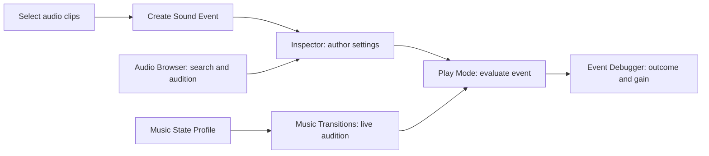

# AudioMW — Editor UI specification

Updated 2026-11-05. The product should feel like a small, native Unity tool.
The designer's main tasks are finding content, authoring an event, checking
playback and understanding why something is silent.

## Navigation and ownership

Browser remains read-only. Clip preview is labelled as source-clip audition,
not a simulation of event processing. Authoring belongs in the Inspector or
Create Sound Event window. Music audition explicitly controls the scene's
runtime in Play Mode.

## Implemented interaction rules

- Use native UI Toolkit fields and Unity serialization so Inspector changes
  participate in Undo and multiple-object editing.
- Start with Playback and its content. Show only fields relevant to Simple,
  Blend, Layered or Switch. Keep Sound visible and put Variation, Spatial,
  Playback limits and Parameter bindings in foldouts.
- Put an actionable validation message next to content: missing clips,
  missing state parameter, empty layers, circular child references.
- Use the native theme and 12 px body text. Reserve bold text for headings;
  avoid decorative cards, gradients and excessive rounded shapes.
- Make Browser panes resizable and the preview scrollable. Indicate active
  filters with text as well as colour. Use Unity icons and GUID-keyed waveforms.
- Label disabled actions with the prerequisite. Creation needs selected clips;
  transition audition needs a valid profile and Play Mode.
- Preserve existing serialized field names and values when reorganizing UI.

These decisions follow [Unity UX Essentials](https://www.foundations.unity.com/fundamentals/ux-essentials),
[Content Organization](https://www.foundations.unity.com/patterns/content-organization),
[Interactions](https://www.foundations.unity.com/fundamentals/interactions), and
[Empty States](https://www.foundations.unity.com/patterns/empty-states).

## Manual acceptance checks

Check dark and light themes, narrow Inspector, a 620 px Browser, long asset
names, large clip lists, keyboard focus, Undo/Redo, multi-selection, missing
references and empty search results. Verify waveform preview remains read-only.
In Play Mode audition a state, inspect pending timing and confirm repeat clicks
do not continually postpone the same destination. Automated compilation is
not visual QA; record the actual checks in implementation-status.md.

## Remaining design work

A decibel-first gain control needs an explicit conversion and serialization
contract. Reference discovery needs a useful navigation destination. A future
transition envelope editor needs measured playback semantics before drawing
curves. Add these after observing pilot workflows, rather than enlarging the
Inspector with speculative controls.
