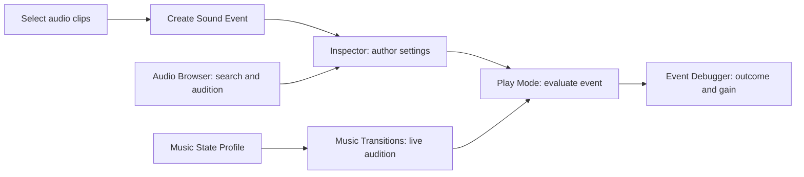

# AudioMW — Editor UI specification

Updated 2026-11-05. The product should feel like a small, native Unity tool.
The designer's main tasks are finding content, authoring an event, checking
playback and understanding why something is silent.

## Navigation and ownership

Browser remains read-only. Clip preview is labelled as source-clip audition,
not a simulation of event processing. Authoring belongs in the Inspector or
Create Sound Event window. Music audition explicitly controls the scene's
runtime in Play Mode.

## Implemented interaction rules

- Use native UI Toolkit fields and Unity serialization so Inspector changes
  participate in Undo and multiple-object editing.
- Start with Playback and its content. Show only fields relevant to Simple,
  Blend, Layered or Switch. Keep Sound visible and put Variation, Spatial,
  Playback limits and Parameter bindings in foldouts.
- Put an actionable validation message next to content: missing clips,
  missing state parameter, empty layers, circular child references.
- Use the native theme and 12 px body text. Reserve bold text for headings;
  avoid decorative cards, gradients and excessive rounded shapes.
- Make Browser panes resizable and the preview scrollable. Indicate active
  filters with text as well as colour. Use Unity icons and GUID-keyed waveforms.
- Label disabled actions with the prerequisite. Creation needs selected clips;
  transition audition needs a valid profile and Play Mode.
- Preserve existing serialized field names and values when reorganizing UI.

These decisions follow [Unity UX Essentials](https://www.foundations.unity.com/fundamentals/ux-essentials),
[Content Organization](https://www.foundations.unity.com/patterns/content-organization),
[Interactions](https://www.foundations.unity.com/fundamentals/interactions), and
[Empty States](https://www.foundations.unity.com/patterns/empty-states).

## Manual acceptance checks

Check dark and light themes, narrow Inspector, a 620 px Browser, long asset
names, large clip lists, keyboard focus, Undo/Redo, multi-selection, missing
references and empty search results. Verify waveform preview remains read-only.
In Play Mode audition a state, inspect pending timing and confirm repeat clicks
do not continually postpone the same destination. Automated compilation is
not visual QA; record the actual checks in implementation-status.md.

## Remaining design work

Gain controls now use native faders with numeric dB entry, explicit silence and
mixed values. Storage stays linear; old variation stays additive while new events
use a separate relative dB range. The 320-point check led to shorter variation
labels and tooltips. See gain-authoring.md for exact semantics and evidence.

Reference discovery needs a useful navigation destination. A future
transition envelope editor needs measured playback semantics before drawing
curves. Add these after observing pilot workflows, rather than enlarging the
Inspector with speculative controls.

## Design 02 implementation

The supplied CODEX-HANDOFF.md supersedes the older automatic-focused-Inspector
idea: ordinary selection follows Unity; pinning is explicit. The Sound Event
workflow is now implemented natively. See sound-event-workflow.md for selection,
source preview, persistence, binding, summaries, creation, emitter assignment and
captured diagnostic navigation. The HTML app stays a reference rather than a
runtime/editor dependency. Native theme variables and controls support dark/light;
Screenshots and real test results are separate from the prototype's historic QA.

Full Diagnostics table redesign, the remaining Music interaction refinements,
inline weighted source/weight editing, broader keyboard/accessibility review and
large-library profiling remain follow-up work. Existing weighted selection,
full blend curves and music scheduling have not been reduced to the prototype.

### Design 02 — Music and Diagnostics follow-up (2026-11-05)

Music uses the shared workspace navigation and the scene runtime explicitly.
Current/Pending distinguish Edit Mode unavailability from a stopped runtime.
Destination buttons show the matching profile route or defaults; a scheduled
transition displays captured quantization, effective fade seconds and curve from
MusicPlayer, so editing a profile cannot rewrite the displayed pending settings.
Cancel is enabled only before the pending DSP boundary. Repeated destinations
retain the existing runtime no-reschedule contract.

Diagnostics uses native Event / Outcome / Reason columns with full row tooltips,
persistent search/rejection filters, explanatory empty states, and the existing
captured reason, gain disclosure and action to event settings. Accepted requests
without gain capture do not claim audibility or zero volume.

## Planned assisted-implementation review

A dedicated onboarding/review window owns project setup; Browser stays read-only.
Ask a short brief only for information not already detected. Show the proposed
result first, exact changes on demand, and one-sentence Why explanations with
measured evidence available separately. Use native controls and explicit
Apply selected / Reject / Why actions. Approval belongs to this Unity UI even if
the external agent client enables automatic tool approval. No change is applied
from merely opening the review or closing a question. Keep plan state, conflicts
and partial results legible. See [agent-assisted-authoring.md](agent-assisted-authoring.md).
This section specifies future UI; no implementation is claimed.
